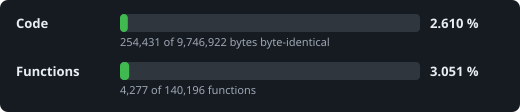

# prototype_decomp

A decompilation of **Prototype** (Radical Entertainment, 2009), PC version: C++ source that rebuilds the game's
engine, `prototypeenginef.dll`, function by function, with the compiler the original was built with (Visual Studio
2005 SP1). The rebuilt DLL is a drop-in replacement for the original in a Steam installation.

> **No game code or assets are included.** You need your own copy of Prototype (Steam, app 10150): buy the game.
> Everything derived from the original binaries is generated locally from that copy and never committed or
> distributed. Not affiliated with or endorsed by Activision or Radical Entertainment, who made the game and its
> engine. Non-commercial; no binary releases. Read [LEGAL.md](LEGAL.md) before contributing.

## Status

<!-- progress:start -->


```text
Code       ███░░░░░░░░░░░░░░░░░░░░░░░░░░░   9.881 %
Functions  ████░░░░░░░░░░░░░░░░░░░░░░░░░░  13.465 %  (18898 / 140347)
  audio       391 functions matched, 13,832 bytes
  choreo      612 functions matched, 34,032 bytes
  container    40 functions matched, 3,592 bytes
  content     264 functions matched, 14,089 bytes
  core       1382 functions matched, 78,379 bytes
  crypto       68 functions matched, 21,076 bytes
  engine    10521 functions matched, 492,357 bytes
  gfx         109 functions matched, 2,534 bytes
  lua         410 functions matched, 36,353 bytes
  math        205 functions matched, 25,523 bytes
  music      1159 functions matched, 36,130 bytes
  om           92 functions matched, 4,516 bytes
  proto       272 functions matched, 31,096 bytes
  pure3d      908 functions matched, 73,358 bytes
  ravenphysics  2411 functions matched, 94,227 bytes
  scaleformp3d    67 functions matched, 2,567 bytes
```

Updated 2026-10-30 by `ninja progress`; details in [docs/progress.md](docs/progress.md).
<!-- progress:end -->

Phase 0: foundation. The hybrid DLL works: the original image relinked with our first matching functions runs the
game into free roam. See [docs/methodology.md](docs/methodology.md) for how, [docs/plan.md](docs/plan.md) for the
phases and [CONTRIBUTING.md](CONTRIBUTING.md) to take part.

## Why?

- **Preservation.** The engine depends on Direct3D 9, 32-bit Windows and dead middleware services; source code
  outlives operating systems, drivers and store updates.
- **Portability.** Source can be built for other operating systems and devices, always running with your own copy of
  the PC game's data.
- **Fixes and improvements.** High frame rates, widescreen and field of view, modern controllers, crashes, and
  graphical upgrades to the renderer, done in the code instead of binary patches.
- **Modding.** Reconstructed headers, names and formats make mods ordinary programming.
- **Understanding.** How a 2009 open-world engine streams a city, runs crowds and its own physics is worth reading.
- **It's fun.**

## Target

| Version | File | SHA-256 |
|---|---|---|
| `PROTOPC_2025` (Steam, after the 2025-09-29 patch) | `prototypeenginef.dll` | `d331be205bdde99897952ee88261ab7e63c5c65e36a4660e2a367886a3537071` |
| | `prototypef.exe` | `0cd6834f72b4fd4a762a8ce7c705bfccc94dec58e404f0c0c09299ec42eb7de6` |

## Getting started

```bash
python tools/pin.py fetch --game "D:/SteamLibrary/steamapps/common/Prototype"   # copy + verify into orig/
python tools/ghidra/ghidra.py import                                             # persistent Ghidra database in local/ghidra
python tools/build.py                                                            # compile, check, relink, verify
python tools/re/testcopy.py                                                      # a test copy of the game with the hybrid DLL
```

Requirements: Python 3.11 with `pyyaml`, `pefile`, `capstone`; Ghidra 12.1+ with JDK 21; the Visual Studio 2005 SP1
compiler, extracted from a free Microsoft SDK by `tools/toolchain/setup_vc8.py` (see [docs/toolchain.md](docs/toolchain.md)).

## Layout

| Path | Purpose |
|---|---|
| `config/<VERSION>/` | per-build configuration: hashes, symbols, splits |
| `orig/` | your original binaries (ignored by git) |
| `src/`, `include/` | the reconstructed source, mirroring the original tree (`code/core`, `code/pure3d`, `code/proto`, …) |
| `thirdparty/` | upstream third-party source the game links (Lua 5.1) |
| `tools/` | Ghidra scripts, build generator, verification |
| `docs/` | methodology, workflow, toolchain, the original's source tree, worklists per module, `address_index.tsv` (2 644 known engine addresses with a topic and a note) |
| `build/`, `local/` | generated output (ignored by git) |

## License

[prototype_decomp License v1](LICENSE.md): source only, non-commercial, no original files or binaries containing the
original program, sold content off by default, attribution, forks under the same license. Policy and reasoning:
[LEGAL.md](LEGAL.md). *Prototype* is a trademark of its owners; the engine and game were created by Radical
Entertainment and published by Activision.
